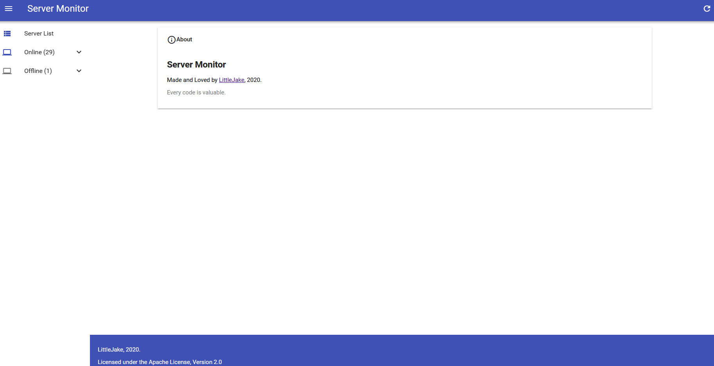
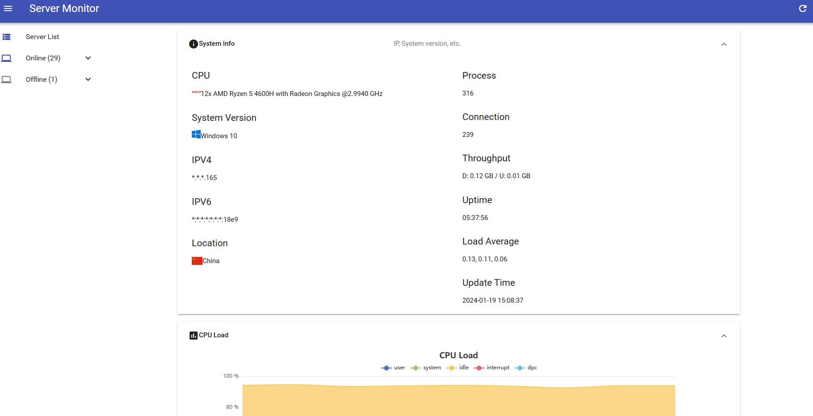
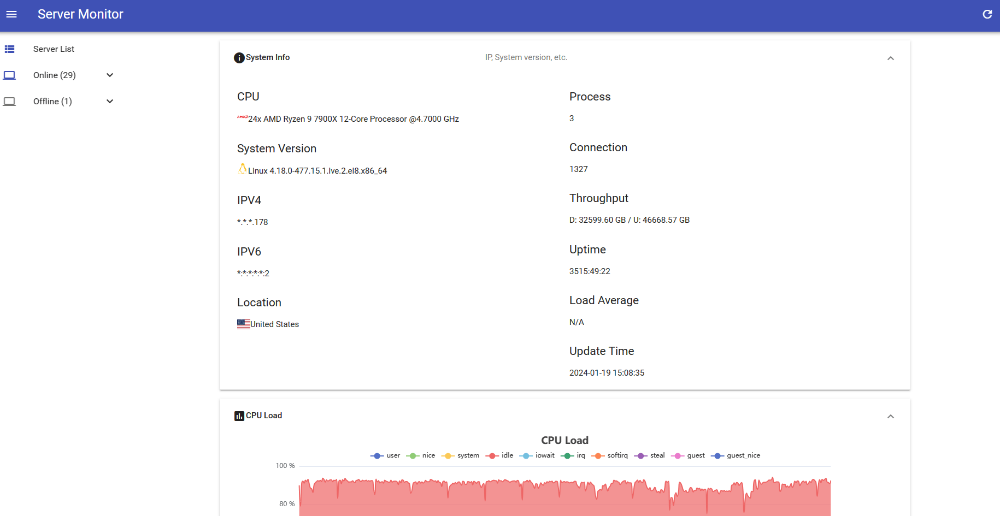
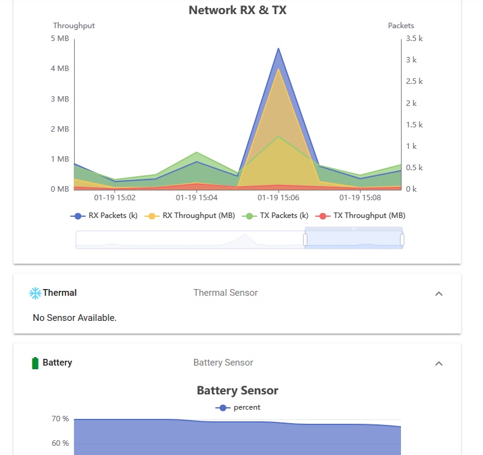

Server Monitor
==========

 


基于ThinkPHP6.1的服务器监控平台，需要配合agent上传服务器信息，使用Redis存储相关数据。

### 使用

#### 安装

```bash
git clone https://github.com/LittleJake/server-monitor
cd server-monitor
composer install
cp .env.example .env
```

#### 从 ThinkPHP 5 升级到 ThinkPHP 6

1. 暂停旧版 API 写入和节点上报，备份旧版代码、`.env`、Redis 数据及其他持久化数据。升级期间保留旧部署，便于回滚。
2. 在旧版导出节点 Token 清单。清单包含明文密钥，请保存在站点目录之外，并限制文件访问权限。

    PowerShell：

    ```powershell
    php think token list | Out-File -Encoding utf8 tp5-token-list.txt
    ```

    Linux/macOS：

    ```bash
    php think token list > tp5-token-list.txt
    ```

3. 在新目录部署 ThinkPHP 6 版本并安装依赖：

    ```bash
    composer install
    ```

    将旧版 `.env` 中仍适用的环境配置迁移到新版；逐项核对 Redis 连接、PHP 版本（至少 7.2.5）和 Web 服务根目录（应指向新版 `public`）。不要直接覆盖新版的 `config` 或复制旧版 `runtime/cache`。
4. 在新版项目目录导入旧 Token 清单：

    ```bash
    php think token import --file ./tp5-token-list.txt
    ```

    导入格式为每行 `UUID: Token`；同 UUID 的已有值会被清单中的值覆盖。
5. 验证节点上报和监控页面正常后，将 Web 服务切换到新版并恢复节点上报。保留旧部署和备份，确认运行稳定后再清理；导入完成后删除临时 Token 清单。

#### API上报节点密钥操作

```bash
php think token help
php think token import --file ./tp5-token-list.txt
```

导入文件使用 `token list` 输出的格式，每行一个 `UUID: Token`。导入时，同 UUID 的现有 Token 会被清单中的值覆盖。

#### 配置Redis数据源

```bash
vim .env
```

#### 刷新数据缓存

```bash
php think refresh:cache
```

### 界面演示









### Demo

[Demo](https://monitor.littlejake.net)

### 数据结构

#### Collection

```json
{
    "Disk": {
        // Based on different mountpoint.
        "mountpoint": {
            "total": "0.00",
            "used": "0.00",
            "free": "0.00",
            "percent": 0
        },
    },
    "Memory": {
        "Mem": {
            "total": "0.00",
            "used": "0.00",
            "free": "0.00",
            "percent": 0.0
        },
        "Swap": {
            "total": "0.00",
            "used": "0.00",
            "free": "0.00",
            "percent": 0.0
        }
    },
    "Load": {
        // Metrics based on platform.
        "metric": 0.0
    },
    "Network": {
        "RX": {
            "bytes": 0,
            "packets": 0
        },
        "TX": {
            "bytes": 0,
            "packets": 0
        }
    },
    "Thermal": {
        // Celsius
        "sensor": 0.0,
    },
    "Battery": {
        "percent": 0.0,
    }
}
```

#### Info

```json
{
    "CPU": "",
    "System Version": "",
    "IPV4": "masked ipv4",
    "IPV6": "masked ipv6",
    "Uptime": "time in readable form",
    "Connection": "",
    "Process": "",
    "Load Average": "",
    "Update Time": "",
    "Country": "extract from ip-api.com",
    "Country Code": "extract from ip-api.com",
    "Throughput": "Gigabytes",
}
```

### 开源协议

[Apache 2.0](LICENSE)

### 鸣谢

[MDUI](https://mdui.org)

[ThinkPHP](https://www.thinkphp.cn/)

[ip-api.com](https://ip-api.com)

升级迁移由Github Copilot完成。

### Sponsors

Thanks for the amazing VM server provided by [DartNode](https://dartnode.com?via=1).

 <a href="https://dartnode.com?via=1"></a>


